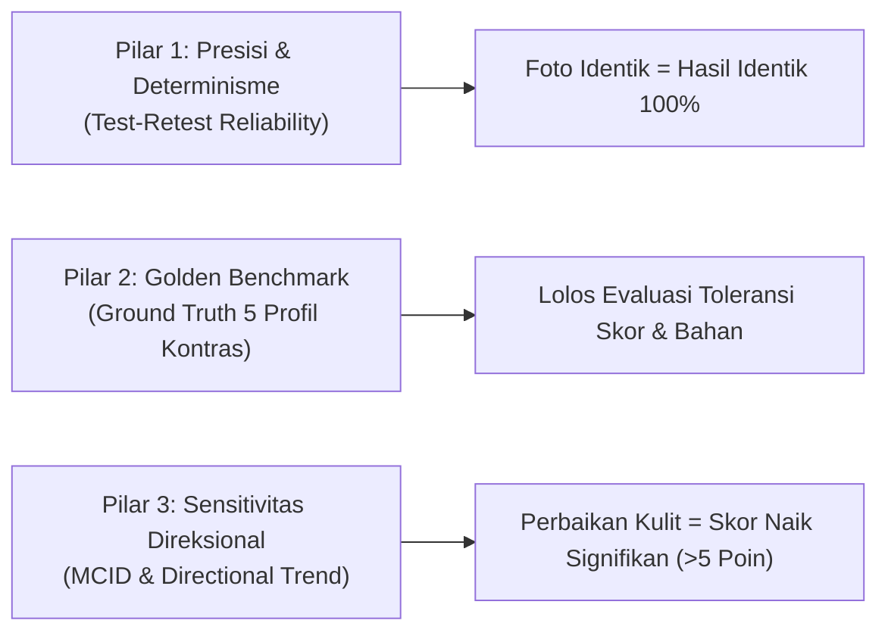

# RFC 022: Framework Pengujian Akurasi & Golden Benchmark Scan Wajah Skincluv

**Status**: DRAFT / APPROVED FOR IMPLEMENTATION  
**Tanggal**: 2026-10-27  
**Penyusun**: `role-asisten` & Lead Engineer Antigravity  
**Dasar Regulasi & Invarian**:  
- UU PDP No. 27/2022 (Minimisasi Data Biometrik)  
- UU Kesehatan No. 17/2023 & Invarian 19 (Non-Therapeutic Claim Boundary — AI Skin Assessment, bukan SaMD)  
- RFC 011 & Invarian 7, 8 (Exact Image Idempotency & Determinisme SHA-256)  
- RFC 013 & Invarian 14 (Clinical Temporal Comparison & Ambang MCID 5 Poin)  

---

## 1. Latar Belakang & Masalah

Fitur Scan Wajah AI (`face_analysis`) Skincluv menghasilkan skor numerik (1–100), tipe kulit (*skin type*), indikasi masalah (*skin concerns*), evaluasi 3 area anatomis (*forehead*, *tzone_cheeks*, *chin_lips*), serta rekomendasi bahan aktif (*recommended_ingredients*).

Sebelumnya, tidak ada tolok ukur acuan (*ground truth*) empiris yang terstandarisasi untuk membuktikan bahwa hasil analisis tersebut **benar, konsisten, dan akurat secara kosmetik**. Membandingkan dengan AI lain di browser tidak valid karena perbedaan parameter acak dan ketiadaan rekam medis acuan.

Dokumen RFC ini menetapkan **Metodologi Pembuktian Akurasi 3 Pilar** dan **5 Profil Golden Benchmark Dataset**.

---

## 2. Tiga Pilar Pembuktian Akurasi

### Pilar 1: Presisi & Determinisme (Test-Retest Consistency)
- **Kriteria Keberhasilan**: Citra yang sama persis (`image_content_hash` identik) yang dikirim berulang kali **WAJIB menghasilkan skor dan keluaran 100% identik**.
- **Mekanisme**: Diimplementasikan melalui `temperature: 0.0`, `seed: 42`, dan *Exact SHA-256 Cache Hit* (Migration 064). Tidak ada variasi acak (*zero random drift*).

### Pilar 2: Golden Benchmark Ground Truth (Toleransi & Validasi Semantik)
Akurasi tidak dinilai dari angka mutlak tunggal (misal 74.00), melainkan dari **kesesuaian rentang klinis (*tolerance window*)** dan **arah rekomendasi bahan aktif**.

### Pilar 3: Sensitivitas Direksional & Ambang MCID
- **Aturan MCID (Invarian 14)**: Fluktuasi selisih < 5 poin dinyatakan sebagai variasi sudut/pencahayaan optik (stabil).
- **Sensitivitas Arah**: Jika kulit mengalami penyembuhan jerawat nyata, skor wajib bergerak naik secara direksional (+6 hingga +20 poin).

---

## 3. Matriks 5 Profil Golden Benchmark (Katalog Acuan Kebenaran)

| ID Profil | Kondisi Optik Wajah | Rentang Skor Sah (Tolerance) | Tipe Kulit Target | Concerns Wajib | Bahan Wajib / Dilarang |
| :--- | :--- | :--- | :--- | :--- | :--- |
| **GB-01: Severe Acne & Oily** | Sebum berlebih merata, pori besar, jerawat/pustula aktif di pipi & dahi. | **45 – 65** | `oily` | `acne`, `large_pores`, `excess_sebum` | **Wajib**: Salicylic Acid, Niacinamide, atau Tea Tree. **Dilarang**: Heavy mineral oil, stearic acid pekat. |
| **GB-02: Dry & Compromised Barrier** | Kering kusam, tidak ada kilap minyak, *flaking* (mengelupas), eritema/kemerahan. | **50 – 68** | `dry` / `sensitive` | `dryness`, `redness`, `barrier_compromised` | **Wajib**: Ceramide, Hyaluronic Acid, Panthenol. **Dilarang**: AHA/BHA tinggi (>5%), retinol pekat. |
| **GB-03: Combination T-Zone** | Kilap minyak di dahi & hidung, tetapi pipi normal/cenderung kering. | **68 – 82** | `combination` | `uneven_texture`, `tzone_oil` | **Wajib**: Hidrasi seimbang, balancing toner (Niacinamide/Zinc). |
| **GB-04: Clear / Optimal Skin** | Tekstur halus, warna kulit merata, barrier utuh, tidak ada lesi aktif. | **85 – 96** | `normal` | `none` atau `mild_dullness` | **Wajib**: Maintenance, Sunscreen, Vitamin C/Antioksidan. |
| **GB-05: Negative Gatekeeper** | Karakter anime 2D, avatar 3D sintetis, botol skincare, atau foto wajah buram ekstrem. | **N/A (Tolak)** | N/A | N/A | **Hasil Wajib**: `is_valid_face = false`. **Biaya**: 0 kredit (Gatekeeper `face_validation`). |

---

## 4. Rencana Implementasi

1. **Seed Ground Truth ke Basis Data**:
   - Memasukkan rekaman profil acuan ke tabel `ai_training_datasets` dengan `quality_tier = 'gold'` dan `is_few_shot_exemplar = true`.
2. **Evaluasi Otomatis (Test Suite Runner)**:
   - Menyiapkan skrip uji validasi otomatis yang mengevaluasi apakah respons AI terhadap sampel benchmark berada di dalam batas toleransi.
3. **Penyajian di Portal Admin**:
   - Admin dapat memantau dan mengaudit dataset acuan langsung di halaman `/admin/training-datasets`.
