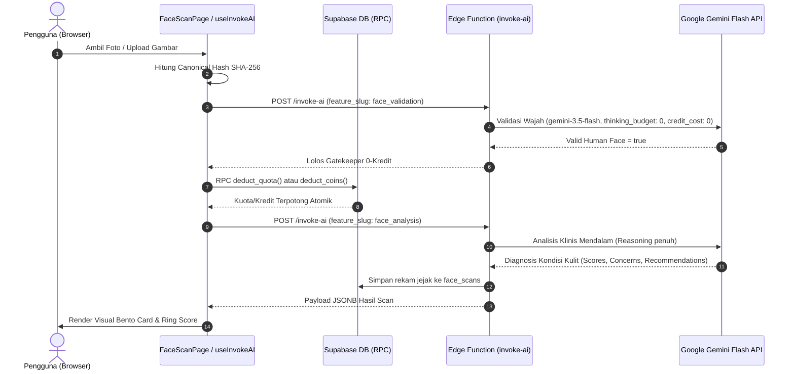
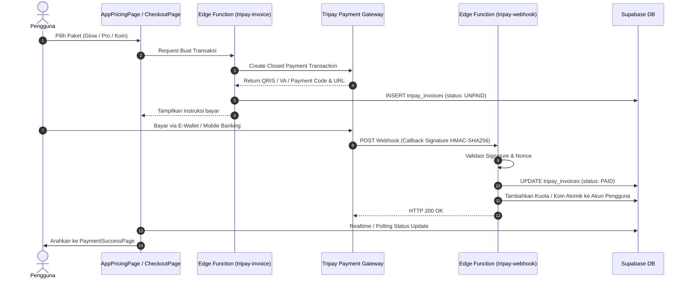

# Project Map: Skincluv

_Terakhir diverifikasi: 2026-10-27, commit `ad07e0d`_  
Detail buku induk paritas antarmuka dan backend dapat dilihat selengkapnya di [docs/architecture/FE_BE_PARITY_MATRIX.md](file:///home/kangjessy/Documents/projects/skinscan/skincluv/docs/architecture/FE_BE_PARITY_MATRIX.md).

---

## 1. Struktur Folder

| Path | Fungsi Utama |
|---|---|
| `src/` | Kode sumber utama frontend aplikasi berbasis React 19 + TypeScript. |
| `src/components/` | Komponen UI modular (Buttons, Modals, Camera Viewfinder, Region Cropper, Cards). |
| `src/pages/public/` | Halaman web publik non-login (Landing page, Terms, Privacy, FAQ, Pricing, About, Refund). |
| `src/pages/app/` | Halaman terproteksi untuk pengguna login (Dashboard, Scan Wajah, Scan Komposisi, Chatbot, Missions, History, Billing, Profile). |
| `src/pages/admin/` | Halaman konsol administrator (Users, Financials WAC, System Health, Audit Logs, AI Handbook, Models). |
| `src/pages/auth/` | Halaman autentikasi & pemulihan sesi (Login, Register, Forgot Password, Reset Password, Auth Callback PKCE). |
| `src/hooks/` | Custom hooks React untuk data fetching, Supabase client RPC, mutasi, dan state logic (`useInvokeAI`, `useDashboardData`, dll). |
| `src/store/` | Client-side state management menggunakan Zustand (`authStore.ts`). |
| `src/styles/cluv/` | **Cluv Micro-Framework**: Desain sistem CSS Vanilla modular (tokens, layout kanvas, surfaces, components, utilities). |
| `src/types/` | Kontrak tipe TypeScript kanonikal yang mencerminkan 1:1 struktur data JSONB database. |
| `src/utils/` | Fungsi pembantu murni (deteksi landmark MediaPipe, format mata uang, format tanggal Indonesia). |
| `supabase/migrations/` | Skrip migrasi PostgreSQL (Tabel, RLS policies, Stored Procedures atomik, Triggers, Indexes). |
| `supabase/functions/` | Edge Functions serverless berbasis Deno (`invoke-ai`, `tripay-invoice`, `tripay-webhook`, `tripay-check-status`). |
| `docs/` | Dokumentasi arsitektur, ADR keputusan teknis, glosarium bisnis, matriks paritas, dan laporan tim peran. |
| `.agents/` | Konfigurasi sistem tim peran, instruksi peran (`role-*`), katalog referensi, template, dan aturan kerja. |

---

## 2. Titik Masuk & Alur Utama

### A. Titik Masuk Aplikasi
1. **Entry Point Web**: `src/main.tsx` menginisialisasi root React, memuat `src/index.css` & Cluv Framework, dan membungkus aplikasi dengan `QueryClientProvider` serta `BrowserRouter`.
2. **Routing & Shell Hub**: `src/App.tsx` mendistribusikan rute ke 3 layout kanonikal:
   - `PublicLayout`: Halaman informasi terbuka dengan topbar transparan.
   - `AppLayout`: Shell pengguna login dengan Sidebar kiri 250px, Topbar 68px, dan Content Host.
   - `AdminLayout`: Shell konsol operasional dengan navigasi metrik sistem dan kontrol RLS admin.
3. **Inisialisasi Autentikasi**: `src/hooks/useAuthInit.ts` memulihkan token sesi Supabase saat cold start dan menyinkronkan profil ke `useAuthStore`.
4. **Sanitasi Callback Auth**: `src/pages/auth/AuthCallbackPage.tsx` segera menghapus parameter URL (`code`, `access_token`) via `window.history.replaceState` untuk mencegah kebocoran sesi ke referer (UU PDP).

### B. Alur Transaksi AI (Face & Ingredient Scan)


### C. Alur Pembayaran & Webhook Tripay


---

## 3. Peta Fitur (UI ↔ API ↔ DB Status)

| Fitur | UI (File) | API / Edge Function | DB (Tabel / RPC) | Status Paritas |
|---|---|---|---|---|
| **Autentikasi & Sesi** | `LoginPage.tsx`, `RegisterPage.tsx` | Supabase Auth API | `auth.users`, `user_profiles` | 🟢 **Nyata / Connected** |
| **Dashboard Ringkasan** | `DashboardPage.tsx` | Supabase RPC | `get_dashboard_overview()` | 🟢 **Nyata / Connected** |
| **Scan Wajah AI** | `FaceScanPage.tsx` | Edge Function `invoke-ai` | `face_scans`, RPC `deduct_coins` | 🟢 **Nyata / Connected** |
| **Scan Komposisi Produk** | `IngredientScanPage.tsx` | Edge Function `invoke-ai` | `ingredient_scans`, `products_catalog` | 🟢 **Nyata / Connected** |
| **Misi Rutin Perawatan** | `MissionsPage.tsx` | Supabase Client & RPC | `user_missions`, `mission_templates` | 🟢 **Nyata / Connected** |
| **Skinsistant AI Chat** | `ChatbotPage.tsx` | Edge Function `invoke-ai` (Qwen) | `chat_sessions`, `chat_messages` | 🟢 **Nyata / Connected** |
| **Riwayat Analisis Kulit** | `ScanHistoryPage.tsx` | Supabase RPC | `get_scan_history` | 🟢 **Nyata / Connected** |
| **Buku Besar Kredit (Koin)**| `CoinHistoryPage.tsx` | Supabase Client | `coin_balances`, `coin_transactions`| 🟢 **Nyata / Connected** |
| **Faktur & Langganan** | `ProfileBillingPage.tsx` | Edge Function `tripay-invoice` | `tripay_invoices`, `user_subscriptions` | 🟢 **Nyata / Connected** |
| **Profil & Preferensi Kulit**| `ProfileSkinPage.tsx` | Supabase Client | `user_skin_profiles` | 🟢 **Nyata / Connected** |
| **Pusat Privasi (UU PDP)** | `PrivacyCenterPage.tsx` | Supabase Client & RPC | Pembersihan atomik data biometrik | 🟢 **Nyata / Connected** |
| **Admin Pengguna & Koin** | `AdminUsersPage.tsx` | Supabase Client (Admin RLS) | `user_profiles`, `coin_balances` | 🟢 **Nyata / Connected** |
| **Admin Audit & Keamanan** | `AdminAuditLogsPage.tsx`| Supabase Client | `system_audit_logs` | 🟢 **Nyata / Connected** |
| **Admin Suhu Provider** | `AdminSystemHealthPage.tsx` | Supabase Client | `ai_provider_health` | 🟢 **Nyata / Connected** |
| **Admin Perbendaharaan WAC**| `AdminFinancialsPage.tsx` | Supabase Client | `provider_deposit_ledgers`, rollups | 🟢 **Nyata / Connected** |

---

## 4. Konvensi Arsitektur & Contoh Kode Nyata

### A. Konvensi Styling UI (Cluv Framework)
Seluruh komponen UI wajib merujuk ke token CSS variables resmi di `:root` tanpa nilai hex hardcoded.
```tsx
// BENAR: Menggunakan class kanonikal Cluv Framework
<div className="cluv-canvas-focused">
  <div className="cluv-card">
    <div className="cluv-card-icon-wrap is-teal">
      <Sparkles size={20} />
    </div>
    <button className="cluv-btn is-primary">Simpan Preferensi</button>
  </div>
</div>

// SALAH (DILARANG): Class ad-hoc / inline hex
<div style={{ backgroundColor: '#1f9d97' }} className="my-custom-box">...</div>
```

### B. Kontrak Integritas RPC ↔ TypeScript (Anti-Drift)
Nama atribut pada `jsonb_build_object` di PostgreSQL wajib cocok 1:1 karakter dengan interface TypeScript consumer-nya.
```sql
-- PostgreSQL Stored Procedure (RPC)
RETURN jsonb_build_object(
  'skin_assessment', v_latest_assessment,
  'scan_counts', jsonb_build_object('face_total', v_face_count),
  'recent_scans', v_scans_json
);
```
```typescript
// TypeScript Consumer (src/hooks/useDashboardData.ts)
export interface DashboardData {
  skin_assessment: SkinAssessmentSummary | null;
  scan_counts: { face_total: number };
  recent_scans: Array<{ type: 'face' | 'ingredient'; ... }>;
}
```

---

## 5. Status Temuan & Kualitas Kode

1. **Linter Status (Oxlint)**: **0 Warnings, 0 Errors** (42 peringatan unused imports, variables, dan escape regex telah dibersihkan secara menyeluruh pada 2026-10-27).
2. **Kompilasi Produksi (`tsc -b && vite build`)**: **0 Errors**, lulus bersih dalam 3.60s.
3. **Database Invariants**: Invarian 1 (`universal_ai`) dan Invarian 2 (`face_validation`) terkunci ganda di level PostgreSQL via CHECK constraints (Migration 081) dan trigger `BEFORE DELETE` (Migration 084).
4. **Refactoring Admin Warisan**: `AdminKnowledgeBasePage.tsx` telah dimigrasikan dari inline styles ke Cluv Framework (`src/styles/admin-knowledge-base.css`).

